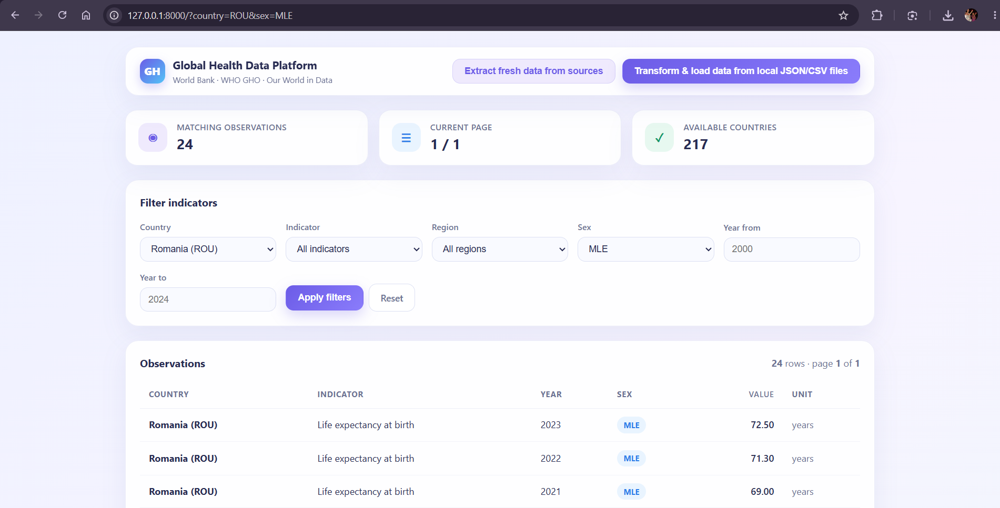
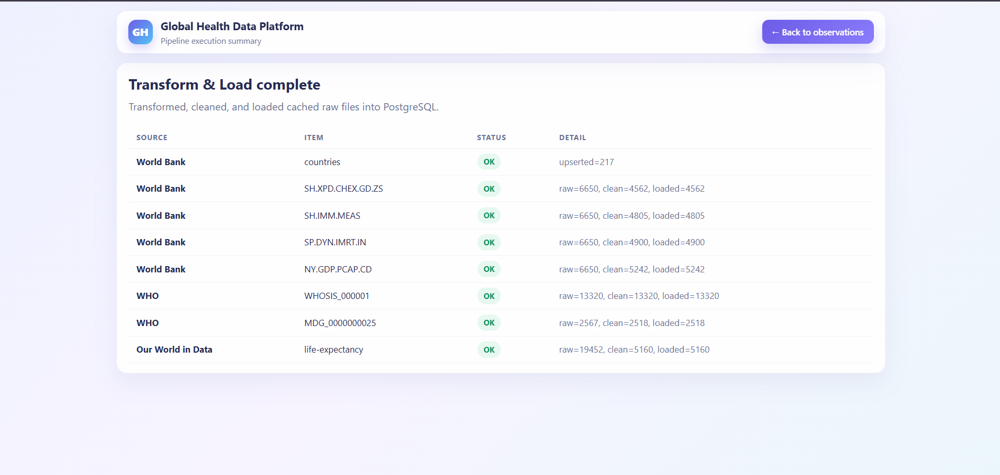

# Lab 3 - Task Results

## Task 3.1: Application Screenshots and Request Call Chain

### 1. Filter combination 1 (`/?country=ROU&sex=MLE`)

### 2. Filter combination 2 with pagination (`/?region=Europe+%26+Central+Asia&page=2`)

### 3. Action result page (`POST /actions/load`)

### Request URL and Call Chain (for screenshot 1)
- **Request URL:** `GET http://127.0.0.1:8000/?country=ROU&sex=MLE`
- **Chain of calls:**
  1. **Controller:** `show_observations()` in `app/controllers/observation_controller.py` receives the request. The dependency `observation_criteria()` parses query parameters (`country="ROU"`, `sex="MLE"`, others default to `None`) into an `ObservationCriteria` domain object, and `page=1`.
  2. **Service:** `ObservationService.get_page(criteria, number=1)` in `app/services/observation_service.py` applies business logic (computes `limit=25`, `offset=0`, total pages, and `has_previous`/`has_next` flags). `ObservationService.get_filter_options()` fetches the drop-down choices.
  3. **Repository:** `ObservationRepository.find(criteria, limit=25, offset=0)` and `ObservationRepository.count(criteria)` in `app/repositories/observation_repository.py` query PostgreSQL using parameterized SQLAlchemy expressions and return immutable `ObservationListItem` domain dataclasses.
  4. **View:** `templates.TemplateResponse()` renders `observations.html` using the returned `ObservationPage` and `FilterOptions` without performing any database queries or business decisions.

---

## Task 3.2: Tracing the `region` Filter Through Every Layer

1. **Form field in `app/templates/observations.html`:**
   Inside `<form method="get" action="/">`, the `<select name="region">` element submits the selected region as a query parameter (`?region=Europe+%26+Central+Asia`). The template keeps the current selection after page reload using `selected`.
2. **Controller parameter parsing (`observation_criteria()` in `app/controllers/observation_controller.py`):**
   FastAPI binds the `region: str | None = None` query parameter and passes it through `blank_to_none(region)` in `app/controllers/form_fields.py`, turning empty strings from an untouched drop-down into `None`.
3. **Shared domain object (`ObservationCriteria.region` in `app/domain.py`):**
   `observation_criteria()` returns an immutable `ObservationCriteria(region="Europe & Central Asia")` dataclass that travels down to the service and repository without exposing any HTTP objects.
4. **Repository filter (`_conditions()` in `app/repositories/observation_repository.py`):**
   When `criteria.region is not None`, `_conditions()` appends `Country.region == criteria.region` to the SQLAlchemy `WHERE` clauses used by both `find()` and `count()`.
5. **Drop-down population (`FilterOptions.regions`):**
   `ObservationRepository.list_regions()` queries distinct non-null `Country.region` values ordered alphabetically and wraps them in `Option` objects; `ObservationService.get_filter_options()` bundles them into `FilterOptions.regions`.
6. **Pagination persistence (`/?region=Europe+%26+Central+Asia&page=2`):**
   In `show_observations()`, `page_url()` calls `request.url.include_query_params(page=number)`. Clicking **Next** preserves `region=...` in the URL across pages (verified on page 2 in screenshot 2).

---

## Task 3.4: Architecture Dependency Rule Test (`tests/test_architecture.py`)

`tests/test_architecture.py` parses `app/domain.py`, `app/repositories/*.py`, and `app/services/*.py` using Python's `ast` module and fails if any file imports `fastapi`, `app.controllers`, or `app.dependencies`.

When `from fastapi import Request` was added temporarily to `app/services/observation_service.py`, running `python -m pytest tests/test_architecture.py -v` failed as expected:

    FAILED tests/test_architecture.py::test_lower_layers_do_not_import_presentation_or_fastapi
    AssertionError: Forbidden layer dependencies found:
      app\services\observation_service.py: imports fastapi
    assert not ['app\services\observation_service.py: imports fastapi']

After removing the forbidden import, all **22 tests** pass cleanly (`22 passed in 1.15s`).
