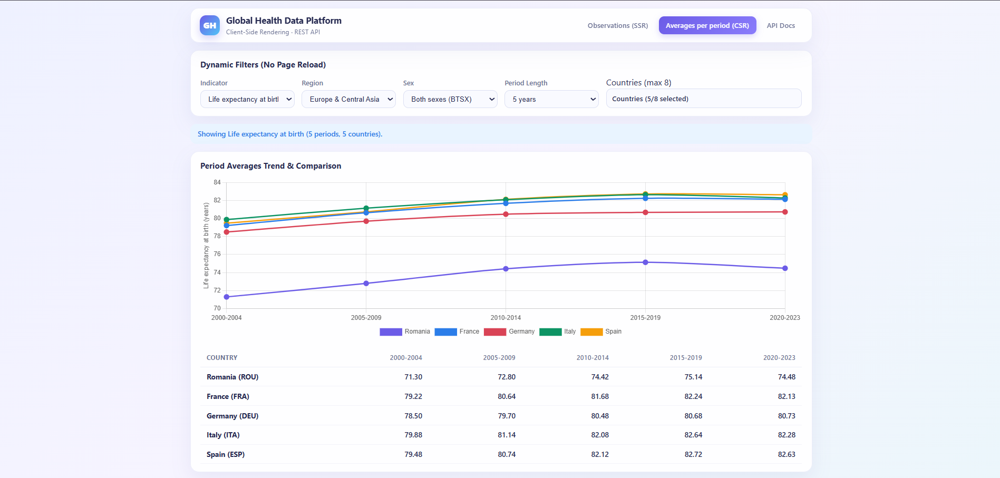
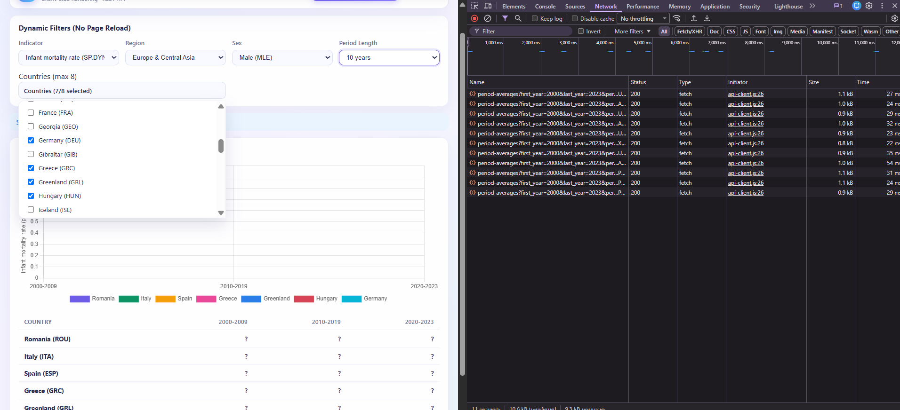

# Lab 4 - Task Results

## Task 4.1: REST API Requests, Responses, and Explanations

All REST endpoints are exposed under `/api`, documented automatically via OpenAPI at `/api/docs` (`/api/openapi.json`), and return JSON responses serialized with Pydantic DTOs (`app/controllers/api/schemas.py`).

### 1. Lookup endpoints (`reference_data_api.py`)
- **Regions (`GET /api/regions` -> `200 OK`):**

      ["East Asia & Pacific", "Europe & Central Asia", "Latin America & Caribbean ", "Middle East, North Africa, Afghanistan & Pakistan", "North America", "South Asia", "Sub-Saharan Africa "]

- **Countries filtered by region (`GET /api/countries?region=Europe+%26+Central+Asia` -> `200 OK`, first 3 of 58):**

      [
        {
          "iso3": "ALB",
          "name": "Albania (ALB)"
        },
        {
          "iso3": "AND",
          "name": "Andorra (AND)"
        },
        {
          "iso3": "ARM",
          "name": "Armenia (ARM)"
        }
      ]

- **Indicators (`GET /api/indicators` -> `200 OK`, first 3 of 8):**

      [
        {
          "code": "MDG_0000000025",
          "name": "Births attended by skilled health personnel (MDG_0000000025)"
        },
        {
          "code": "SH.XPD.CHEX.GD.ZS",
          "name": "Current health expenditure (% of GDP) (SH.XPD.CHEX.GD.ZS)"
        },
        {
          "code": "NY.GDP.PCAP.CD",
          "name": "GDP per capita (NY.GDP.PCAP.CD)"
        }
      ]

### 2. Period averages endpoint (`period_average_api.py`)
- **Request (`200 OK`):**
  `GET /api/indicators/WHOSIS_000001/period-averages?country=ROU&country=FRA&first_year=2000&last_year=2023&period_years=5`
- **Response (JSON):**

      {
        "indicator": {
          "code": "WHOSIS_000001",
          "name": "Life expectancy at birth",
          "unit": "years"
        },
        "periods": [
          {
            "start": 2000,
            "end": 2004,
            "label": "2000-2004"
          },
          {
            "start": 2005,
            "end": 2009,
            "label": "2005-2009"
          },
          {
            "start": 2010,
            "end": 2014,
            "label": "2010-2014"
          },
          {
            "start": 2015,
            "end": 2019,
            "label": "2015-2019"
          },
          {
            "start": 2020,
            "end": 2023,
            "label": "2020-2023"
          }
        ],
        "series": [
          {
            "country_iso3": "ROU",
            "country_name": "Romania",
            "averages": [
              71.3,
              72.8,
              74.42,
              75.14,
              74.48
            ]
          },
          {
            "country_iso3": "FRA",
            "country_name": "France",
            "averages": [
              79.22,
              80.64,
              81.68,
              82.24,
              82.13
            ]
          }
        ]
      }

### 3. Error handling and status codes
- **Unknown indicator (`GET /api/indicators/UNKNOWN/period-averages?country=ROU` -> `404 Not Found`):**

      {"detail": "unknown indicator 'UNKNOWN'"}

  The service raises `UnknownIndicatorError`, which `get_period_averages()` maps to HTTP `404`.
- **Invalid query parameter (`GET /api/indicators/WHOSIS_000001/period-averages?period_years=0` -> `422 Unprocessable Content`):**

      {"detail": [{"type": "greater_than_equal", "loc": ["query", "period_years"], "msg": "Input should be greater than or equal to 1", "input": "0", "ctx": {"ge": 1}}]}

  FastAPI validates `Query(ge=1)` before calling the service and rejects invalid parameters with `422`.
- **REST concepts applied:** Resources use plural nouns (`/api/countries`, `/api/indicators`, `/api/regions`), sub-resources continue the parent URI (`/api/indicators/{code}/period-averages`), all read endpoints use safe and idempotent `GET` requests, and repeated query parameters (`?country=ROU&country=FRA`) select multiple countries cleanly.

---

## Task 4.2: Client-Side Rendering Screenshots and SSR vs. CSR Comparison

### 1. Client-side rendered page (`/period-averages`)

### 2. Browser Developer Tools (`F12` -> Network tab)

**Observation from DevTools:**
- On initial load, the browser receives the HTML shell (`period-averages`, `200 document`, 18.0 kB) and the JavaScript modules (`period-averages-page.js`, `api-client.js`, `period-averages-model.js`, `period-averages-view.js`, plus `chart.umd.min.js`) once.
- On every subsequent filter change (indicator, region, sex, period length, or toggling countries), **the page does not reload**: `api-client.js` sends lightweight `fetch()` GET requests (~0.9?1.2 kB JSON payloads, `200 OK`) and JavaScript updates only the Chart.js canvas and the table rows.

### Server-Side Rendering (Lab 3) vs. Client-Side Rendering (Lab 4)

| Aspect | Server-Side Rendering (Lab 3 - `/`) | Client-Side Rendering (Lab 4 - `/period-averages`) |
| :--- | :--- | :--- |
| **Where HTML is built** | On the server with Jinja2 templates | In the browser with JavaScript DOM manipulation |
| **Server response on filter change** | Complete HTML page | Plain JSON data (`DTOs`) |
| **Network behavior** | Full page request & reload on every submit/link | Background `fetch()` call; only chart & table update |
| **Without JavaScript** | Works completely | Shows only the empty HTML shell |
| **API reuse** | Coupled to HTML templates | Same REST API can serve mobile apps, notebooks, or other clients |
| **Code organization** | Python only (`controller -> service -> repository`) | Two languages (Python backend + layered JS frontend) joined by DTO contract |

---

## Task 4.4: Single Indicator Endpoint and DTOs Explanation

### Endpoint: `GET /api/indicators/{indicator_code}`
- **Request:** `GET /api/indicators/WHOSIS_000001` -> **`200 OK`**

      {
        "code": "WHOSIS_000001",
        "name": "Life expectancy at birth",
        "unit": "years"
      }

- **Unknown code:** `GET /api/indicators/NOT_EXIST` -> **`404 Not Found`** (`{"detail": "unknown indicator 'NOT_EXIST'"}`).

### Why REST controllers return Pydantic DTOs (`schemas.py`) instead of domain types or ORM models
1. **Public contract stability:** Clients (the browser JS, notebooks, external consumers) depend on the JSON field names. Renaming an internal column or domain attribute only requires updating `from_domain()` / `from_option()` in `app/controllers/api/schemas.py`.
2. **Representation control:** In Python, averages are `Decimal` objects; `_to_number()` converts them to JSON floats (`71.3` instead of `"71.30"`) so Chart.js can plot them directly as numbers. Generic `Option(value, label)` objects become explicit `{"iso3", "name"}` and `{"code", "name"}` structures.
3. **Data hiding:** Internal database surrogate keys (`indicator_id`, `observation_count`, `source_id`) stay inside the server and are never exposed in the public API.
